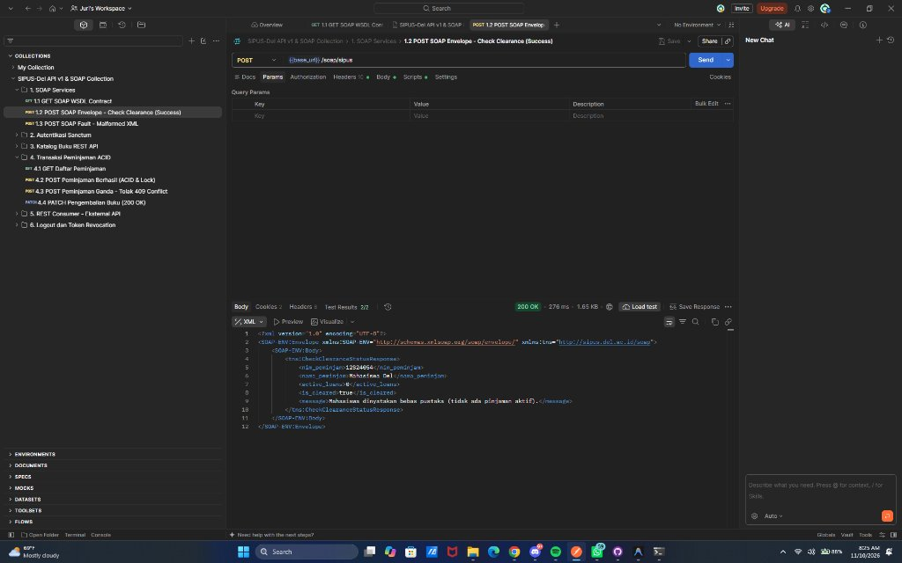
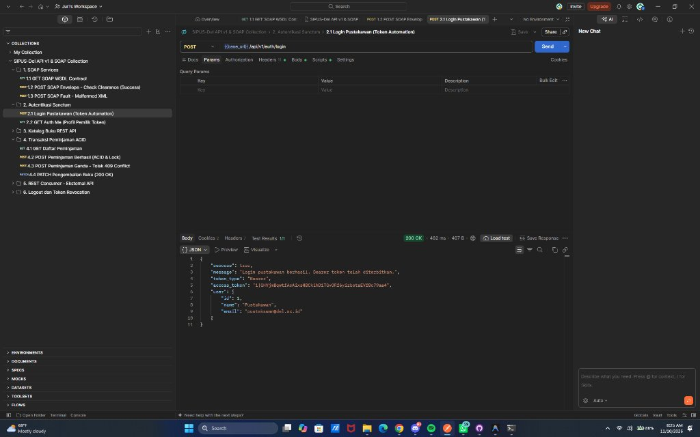
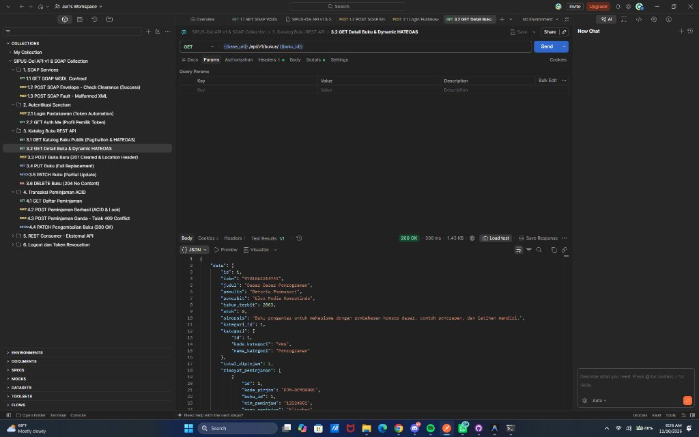
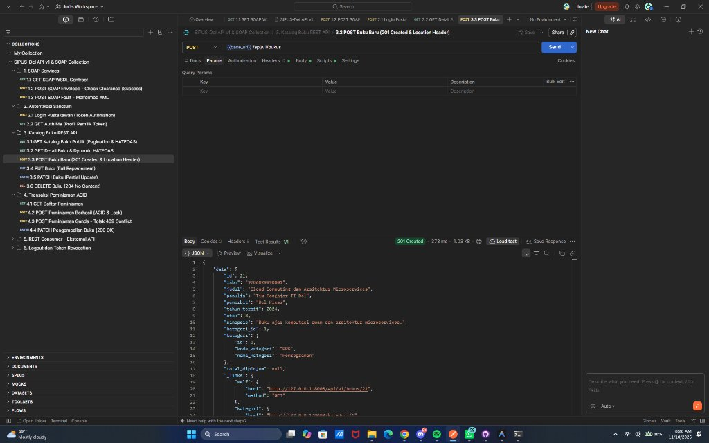
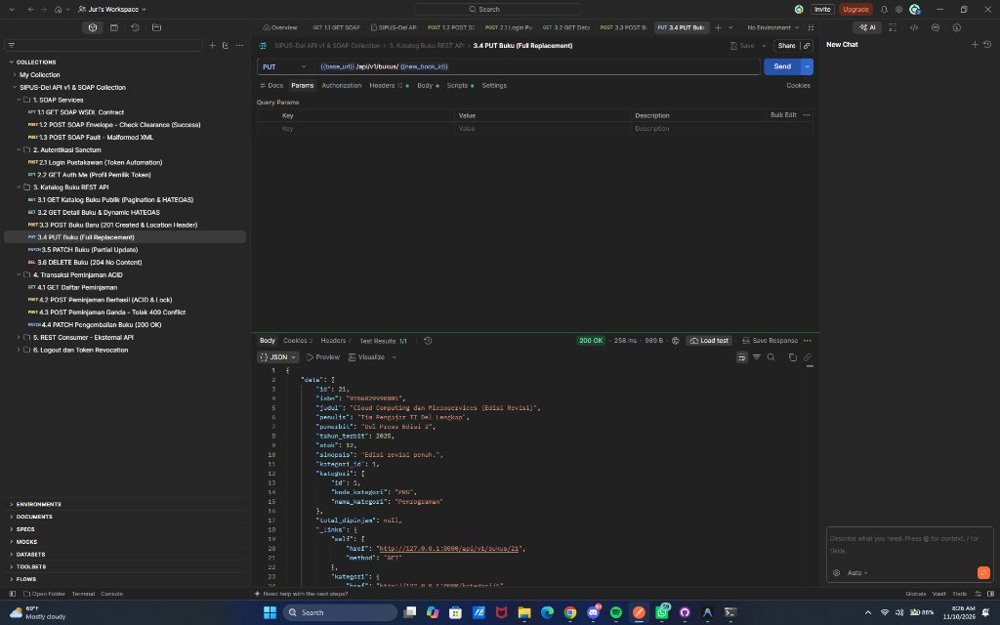

# SIPUS-Del — Tahap 3 (Web Services & RESTful API)

Sistem Informasi Perpustakaan Institut Teknologi Del (SIPUS-Del) Tahap 3 merupakan pengembangan lanjutan dari sistem perpustakaan Minggu 6. Pada tahap ini, SIPUS-Del dilengkapi dengan arsitektur **Web Services** hibrida: **SOAP Web Service** untuk integrasi sistem bebas pustaka akademik, **RESTful API Provider** untuk integrasi aplikasi mobile/kiosk katalog dan sirkulasi peminjaman berintegritas tinggi (ACID), serta **REST Service Consumer** untuk pengayaan metadata buku (OpenLibrary API) dan repositori (GitHub REST API).

---

## 1. Identitas Mahasiswa
- **Nama Lengkap:** Rahel Silaban
- **NIM:** 12S24054
- **Kelas:** 12S1 (S1 Sistem Informasi 2024)
- **Program Studi:** Sarjana Sistem Informasi
- **Mata Kuliah:** 12S3101 - Pengembangan Pemrograman Web (PPW)
- **Institut:** Institut Teknologi Del
- **Branch Pengembangan:** `week9-rest-api`
- **Versi Framework:** Laravel 13 (`^13.0` / `13.34.0`), PHP `8.4.26 (cli)`

---

## 2. Analisis Kebutuhan & Kelayakan Web Services

### 2.1 Analisis Kebutuhan Sistem & Kelayakan (Feasibility)
1. **Interoperabilitas Bebas Pustaka (SOAP):** Sistem Informasi Akademik (SIA/BAAK) memerlukan layanan terstandarisasi untuk memverifikasi apakah calon wisudawan masih memiliki pinjaman aktif di perpustakaan. SOAP dipilih karena menggunakan kontrak formal (WSDL), format XML yang ketat, dan protokol enterprise yang didukung sistem legacy akademik.
2. **Katalog & Kiosk Mandiri (REST):** Mahasiswa dan staf membutuhkan antarmuka yang ringan, cepat, dan stateless untuk pencarian katalog buku, detail ketersediaan stok, serta riwayat sirkulasi melalui aplikasi mobile dan kiosk kampus.
3. **Integritas Sirkulasi ACID:** Operasi peminjaman dan pengembalian buku rentan terhadap *race condition* (stok minus atau peminjaman ganda). Dibutuhkan mekanisme transaksi atomik dan penguncian baris (*pessimistic locking* via `lockForUpdate()`).
4. **Keamanan Tanpa Status (Stateless Security):** REST API tidak boleh bergantung pada session cookie browser, melainkan menggunakan token berbasis header `Authorization: Bearer <token>` via Laravel Sanctum.
5. **Standarisasi Galat RFC 7807:** Setiap respons kegagalan API harus menyajikan format *Problem Details* dengan `Content-Type: application/problem+json` agar klien dapat mendeteksi tipe dan detail kesalahan secara konsisten.
6. **Eksternal Metadata (Service Consumer):** Perpustakaan mengonsumsi data buku global (OpenLibrary API) untuk melengkapi metadata (jumlah halaman, edisi, dan penerbit) secara otomatis tanpa menimpa data primer lokal.

### 2.2 Matriks Peran Service Provider vs Service Consumer pada SIPUS-Del

| Dimensi | Service Provider (Penyedia Layanan) | Service Consumer (Konsumen Layanan) |
|---|---|---|
| **Definisi** | Sistem yang membuka endpoint API untuk dikonsumsi oleh aplikasi lain. | Sistem yang memanggil atau mengonsumsi endpoint API milik pihak ketiga/eksternal. |
| **Peran di SIPUS-Del** | Menyediakan SOAP endpoint (`/soap/sipus`) dan REST API katalog/peminjaman (`/api/v1/bukus`, `/api/v1/peminjamans`). | Mengonsumsi OpenLibrary API (`openlibrary.org`) dan GitHub REST API (`api.github.com`). |
| **Tanggung Jawab** | Validasi input, otentikasi token, eksekusi query database, pengembalian status code yang tepat, pemeliharaan kontrak WSDL/OpenAPI. | Penanganan konektivitas jaringan, batas timeout, *rate limiting*, *token security*, dan *graceful fallback* saat API luar mengalami gangguan. |
| **Format Pertukaran** | Menghasilkan XML Envelope (SOAP) dan JSON / RFC 7807 (REST). | Mengurai (parse) payload JSON dari penyedia eksternal. |

### 2.3 Komparasi Ringkas SOAP vs REST untuk Studi Kasus Perpustakaan

| Kriteria Evaluasi | SOAP Web Service | RESTful Web API |
|---|---|---|
| **Protokol / Gaya Arsitektur** | Protokol formal berbasis XML (W3C standard). | Gaya arsitektur (*architectural style*) berbasis HTTP standard. |
| **Kontrak Layanan** | Sangat ketat menggunakan kontrak WSDL (*Web Services Description Language*). | Fleksibel menggunakan OpenAPI 3.0 / Swagger specification. |
| **Format Pesan** | Wajib XML (*Envelope, Header, Body, Fault*). | Fleksibel (umumnya JSON, bisa XML, YAML, HTML). |
| **Metode HTTP** | Umumnya menggunakan POST untuk seluruh operasi pertukaran envelope. | Memanfaatkan kata kerja HTTP standar (GET, POST, PUT, PATCH, DELETE). |
| **Status Code & Galat** | Kesalahan dikemas dalam elemen `<SOAP-ENV:Fault>` di dalam Body XML. | Menggunakan HTTP status codes (200, 201, 204, 400, 401, 404, 409, 422, 500) dan RFC 7807. |
| **Stateful vs Stateless** | Dapat dirancang stateful atau stateless. | Murni stateless (*client-server separation*). |
| **Kasus Penggunaan di SIPUS** | Verifikasi Bebas Pustaka untuk integrasi sistem BAAK/Akademik (`/soap/sipus`). | Katalog buku, peminjaman mahasiswa, dan autentikasi pustakawan (`/api/v1/*`). |

---

## 3. Tabel Katalog Endpoint Web Services (SOAP & REST API v1)

### 3.1 SOAP Web Service
| Method | URI (Endpoint) | Proteksi Auth | Deskripsi | Kode Status Respons |
|---|---|---|---|---|
| `GET` | `/soap/sipus.wsdl` | Publik | Menampilkan dokumen kontrak WSDL 1.1 formal XML | `200 OK` |
| `POST` | `/soap/sipus` | Publik / M2M | Memeriksa kelayakan bebas pustaka mahasiswa berdasarkan NIM | `200 OK` (Sukses / Terpenuhi), `500 Internal Server Error` (SOAP Fault) |

### 3.2 RESTful Web API Provider & Consumer (v1)
| Method | URI (Endpoint) | Proteksi Auth | Deskripsi | Kode Status Respons |
|---|---|---|---|---|
| `POST` | `/api/v1/auth/login` | Publik | Login pustakawan & menerbitkan Bearer Token Sanctum | `200 OK`, `401 Unauthorized` |
| `GET` | `/api/v1/auth/me` | Bearer Token | Melihat profil pemilik token aktif yang sedang terautentikasi | `200 OK`, `401 Unauthorized` |
| `POST` | `/api/v1/auth/logout` | Bearer Token | Mencabut (revoke) Bearer Token aktif dari database | `200 OK`, `401 Unauthorized` |
| `GET` | `/api/v1/bukus` | Publik | Katalog publik dengan paginasi, pencarian, filter, sorting, dan HATEOAS | `200 OK` |
| `GET` | `/api/v1/bukus/{id}` | Publik | Detail buku beserta relasi kategori dan riwayat peminjaman | `200 OK`, `404 Not Found` |
| `POST` | `/api/v1/bukus` | Bearer Token | Menambahkan judul buku baru perpustakaan | `201 Created` (Header `Location`), `401`, `422` |
| `PUT` | `/api/v1/bukus/{id}` | Bearer Token | Full Replacement data buku (seluruh field wajib dikirimkan) | `200 OK`, `401`, `404`, `422` |
| `PATCH` | `/api/v1/bukus/{id}` | Bearer Token | Partial Update atribut buku tertentu (mendukung pembaruan sebagian kolom) | `200 OK`, `401`, `404`, `422` |
| `DELETE` | `/api/v1/bukus/{id}` | Bearer Token | Menghapus buku (blokir 409 jika buku masih memiliki pinjaman aktif) | `204 No Content`, `401`, `404`, `409 Conflict` |
| `GET` | `/api/v1/bukus/{id}/referensi-eksternal` | Publik | REST Consumer mengonsumsi OpenLibrary API via ISBN buku dengan fallback | `200 OK`, `404 Not Found` |
| `GET` | `/api/v1/github/repo` | Publik / Token | REST Consumer mengonsumsi GitHub REST API dengan token disensor | `200 OK` |
| `GET` | `/api/v1/peminjamans` | Bearer Token | Daftar transaksi sirkulasi peminjaman (filter status dan NIM) | `200 OK`, `401 Unauthorized` |
| `GET` | `/api/v1/peminjamans/{id}` | Bearer Token | Detail riwayat transaksi peminjaman | `200 OK`, `401`, `404 Not Found` |
| `POST` | `/api/v1/peminjamans` | Bearer Token | Transaksi peminjaman ACID atomik dengan pessimistic locking (lockForUpdate) | `201 Created` (Header `Location`), `401`, `409 Conflict`, `422 Unprocessable` |
| `PATCH` | `/api/v1/peminjamans/{id}/kembalikan` | Bearer Token | Transaksi pengembalian buku ACID dan pemulihan stok buku | `200 OK`, `401`, `404`, `409 Conflict` |

---

## 4. Panduan Instalasi & Pengujian Cepat

### 4.1 Perintah Instalasi & Penyiapan Lingkungan
Jalankan perintah berikut secara berurutan pada terminal:

```powershell
# 1. Unduh seluruh dependensi composer
composer install

# 2. Siapkan file konfigurasi environment
cp .env.example .env
php artisan key:generate

# 3. Jalankan migrasi dan isi data awal pengujian (Seeder)
php artisan migrate:fresh --seed

# 4. Jalankan automated test suite untuk memverifikasi fungsionalitas
php artisan test

# 5. Jalankan server lokal
php artisan serve
```

### 4.2 Akun Uji Pustakawan
Untuk login pustakawan pada REST API (`/api/v1/auth/login`) dan Web Blade (`/login`):
- **Email:** `pustakawan@del.ac.id`
- **Password:** `password123`
- **Role:** Administrator / Pustakawan SIPUS-Del

### 4.3 Cara Mengimpor Koleksi Postman dari Folder `docs/`
1. Buka aplikasi **Postman**.
2. Klik tombol **Import** pada pojok kiri atas.
3. Pilih file koleksi yang berada pada repositori:
   📂 [`docs/SIPUS-Del-API-v1.postman_collection.json`](docs/SIPUS-Del-API-v1.postman_collection.json)
4. Pastikan variabel koleksi `base_url` bernilai `http://127.0.0.1:8000`.
5. Eksekusi request **2.1 Login Pustakawan**: token Bearer Sanctum akan secara otomatis tersimpan ke variabel `{{token}}` untuk mengeksekusi request privat berikutnya.

---

## 5. Galeri Bukti Pengujian (Screenshots & Respons Sistem) — Seluruh 7 Skenario Wajib (Poin 5.3.5)

Seluruh pengujian dijalankan dan divalidasi secara langsung pada sistem aplikasi:

### 5.1 Skenario 1: Pengujian SOAP XML Envelope dan SOAP Fault
- **WSDL Contract:** Mengakses `GET /soap/sipus.wsdl` menghasilkan kontrak WSDL 1.1 valid dengan status HTTP 200.
- **Bebas Pustaka Terpenuhi:** Mengirimkan envelope dengan NIM `12S24054` yang tidak memiliki pinjaman aktif menghasilkan:
  ```xml
  <SOAP-ENV:Envelope xmlns:SOAP-ENV="http://schemas.xmlsoap.org/soap/envelope/" xmlns:tns="http://sipus.del.ac.id/soap">
      <SOAP-ENV:Body>
          <tns:CheckClearanceStatusResponse>
              <nim_peminjam>12S24054</nim_peminjam>
              <active_loans>0</active_loans>
              <is_cleared>true</is_cleared>
              <message>Mahasiswa dinyatakan bebas pustaka (tidak ada pinjaman aktif).</message>
          </tns:CheckClearanceStatusResponse>
      </SOAP-ENV:Body>
  </SOAP-ENV:Envelope>
  ```
- **Bukti Screenshot Postman:**
  

- **SOAP Fault (Malformed XML):** Mengirimkan XML cacat menghasilkan HTTP 500 dengan SOAP Fault:
  ```xml
  <SOAP-ENV:Envelope xmlns:SOAP-ENV="http://schemas.xmlsoap.org/soap/envelope/">
      <SOAP-ENV:Body>
          <SOAP-ENV:Fault>
              <faultcode>SOAP-ENV:Client</faultcode>
              <faultstring>Format XML request cacat atau tidak valid (Malformed XML).</faultstring>
          </SOAP-ENV:Fault>
      </SOAP-ENV:Body>
  </SOAP-ENV:Envelope>
  ```

### 5.2 Skenario 2: Login Bearer Token Sanctum
- **POST /api/v1/auth/login** mengembalikan HTTP 200 dengan plainTextToken:
  ```json
  {
    "success": true,
    "message": "Login pustakawan berhasil. Bearer token telah diterbitkan.",
    "token_type": "Bearer",
    "access_token": "1|5aYt4m...sampleToken",
    "user": { "id": 1, "name": "Pustakawan", "email": "pustakawan@del.ac.id" }
  }
  ```
- **Bukti Screenshot Postman:**
  

- **Penolakan Galat (401 RFC 7807):** Login gagal atau request tanpa token mengembalikan `application/problem+json` dengan status 401.

### 5.3 Skenario 3: GET Katalog Buku dengan Pagination & HATEOAS
- **GET /api/v1/bukus?page=1&per_page=5** menghasilkan daftar koleksi buku dengan pagination `meta` dan tautan HATEOAS kontekstual:
  - Buku dengan `stok > 0` memuat `_links.pinjam_buku`.
  - Buku dengan `stok = 0` tidak menyertakan `_links.pinjam_buku`.
- **Bukti Screenshot Postman:**
  

### 5.4 Skenario 4: POST Buku Baru dengan 201 Created & Header Location
- **POST /api/v1/bukus** dengan header `Authorization: Bearer <token>`:
  - Status: `201 Created`
  - Header: `Location: http://127.0.0.1:8000/api/v1/bukus/21`
  - Body: JSON representasi BukuResource lengkap beserta relasi kategori.
- **Bukti Screenshot Postman:**
  

### 5.5 Skenario 5: Perbedaan PUT (Full Replacement) dan PATCH (Partial Update)
- **PUT /api/v1/bukus/{id}:** Menolak request jika salah satu atribut wajib dihilangkan (menghasilkan 422 Problem Details). Berhasil memperbarui data hanya jika seluruh atribut buku dikirimkan.
- **PATCH /api/v1/bukus/{id}:** Berhasil memperbarui sebagian atribut saja (misalnya hanya mengirimkan `{"stok": 15}`) tanpa menghilangkan atau membatalkan atribut judul/penulis/penerbit lainnya.
- **Bukti Screenshot Postman:**
  

### 5.6 Skenario 6: Transaksi Peminjaman ACID, Penolakan Stok Habis (422), dan Konflik (409)
- **Peminjaman Berhasil (201 Created):** Stok buku didekremen secara aman, transaksi tercatat dengan kode pinjam unik, mengembalikan header `Location`.
- **Penolakan Stok Habis (422 RFC 7807):** Jika stok buku bernilai 0, transaksi otomatis dibatalkan (*rollback*) dengan status 422:
  ```json
  {
    "type": "https://tools.ietf.org/html/rfc4918#section-11.2",
    "title": "Unprocessable Content",
    "status": 422,
    "detail": "Stok buku habis. Transaksi peminjaman ditolak.",
    "instance": "/api/v1/peminjamans"
  }
  ```
- **Penolakan Pinjaman Ganda (409 Conflict):** Jika mahasiswa dengan NIM yang sama masih memiliki pinjaman aktif untuk buku yang sama, transaksi ditolak dengan HTTP 409 Conflict Problem Details.
- **Pengembalian Buku (200 OK):** Mengubah status menjadi `dikembalikan`, mengisi `tanggal_kembali`, dan menginkremen stok buku. Pengembalian kedua ditolak dengan HTTP 409 (*Double return prevention*).

### 5.7 Skenario 7: Pengujian REST API Consumer (OpenLibrary & GitHub API)
- **OpenLibrary API:** Mengonsumsi metadata buku eksternal via ISBN dengan timeout 8 detik dan fallback otomatis yang transparan.
- **GitHub REST API v3:** Mengonsumsi data repositori `Rahelsilaban/ppw-2026-week6-12S24054` dengan token disensor:
  ```json
  {
    "success": true,
    "source": "GitHub REST API v3",
    "authenticated": true,
    "token_used": "ghp_****...1234",
    "repository": {
      "name": "ppw-2026-week6-12S24054",
      "owner": "Rahelsilaban",
      "html_url": "https://github.com/Rahelsilaban/ppw-2026-week6-12S24054"
    }
  }
  ```

---

## 6. Penjelasan Teknis Implementasi Arsitektur

### 6.1 Autentikasi Stateless dengan Laravel Sanctum
- REST API SIPUS-Del menggunakan `Laravel\Sanctum` untuk menerbitkan *Personal Access Token* yang disimpan dalam bentuk hash SHA-256 pada tabel `personal_access_tokens`.
- Setiap permintaan ke rute privat diverifikasi melalui middleware `auth:sanctum`.
- Logout mencabut token yang bersangkutan via `$request->user()->currentAccessToken()->delete()`, sehingga token tidak dapat digunakan kembali.

### 6.2 Transaksi ACID dan Pessimistic Locking
- Peminjaman dan pengembalian dibungkus dalam `DB::transaction(callback, 3)` untuk menjamin **Atomicity** dan **Durability**.
- Penguncian baris eksplisit `lockForUpdate()` diterapkan pada tabel `bukus` dan `peminjamans` untuk menjamin **Isolation** terhadap *race condition*.
- Urutan penguncian baris konsisten (selalu mengunci buku terlebih dahulu sebelum peminjaman) untuk mencegah *deadlock*.
- **Consistency** ditegakkan dengan menolak peminjaman jika stok < 1 (422) atau jika mahasiswa masih meminjam buku yang sama (409 Conflict), serta menolak pengembalian berulang (409 Conflict).

### 6.3 Dynamic HATEOAS (Hypermedia As The Engine Of Application State)
- Pada [`BukuResource.php`](app/Http/Resources/BukuResource.php): Tautan `pinjam_buku` disajikan di dalam `_links` secara dinamis **hanya jika** `stok > 0`. Jika stok 0, aksi pinjam tidak disediakan.
- Pada [`PeminjamanResource.php`](app/Http/Resources/PeminjamanResource.php): Tautan `kembalikan_buku` disajikan di dalam `_links` **hanya jika** status pinjaman bernilai `dipinjam`. Jika status telah `dikembalikan`, tautan tersebut otomatis dihilangkan.

### 6.4 RFC 7807 Global Error Handling (Problem Details)
- Dikonfigurasi secara global pada `bootstrap/app.php` melalui kelas [`App\Exceptions\ProblemDetails`](app/Exceptions/ProblemDetails.php).
- Menghasilkan `Content-Type: application/problem+json` dengan struktur wajib: `type`, `title`, `status`, `detail`, dan `instance`.
- Menangani seluruh galat API tanpa menghasilkan redirect HTML:
  - `401 Unauthorized`: Akses tanpa Bearer token atau token invalid.
  - `404 Not Found`: Model / endpoint tidak ditemukan.
  - `409 Conflict`: Benturan status pinjaman aktif atau duplikasi sirkulasi.
  - `422 Unprocessable Content`: Validasi atribut atau stok habis.
  - `500 Internal Server Error`: Kesalahan server internal.

### 6.5 Kontrak OpenAPI 3.0
- Kontrak resmi tersimpan pada [`docs/openapi-sipus-v1.yaml`](docs/openapi-sipus-v1.yaml).
- Memuat spesifikasi lengkap untuk seluruh endpoint SOAP dan REST, skema request/response, komponen security `bearerAuth`, dan contoh representasi data.

---

## 7. Status Pengujian Otomatis (Automated Testing)
Seluruh fungsionalitas diuji melalui PHPUnit Feature & Unit Test Harness:

```powershell
php artisan test
```

**Hasil:**
- **58 Tests Passed**
- **899 Assertions Passed**
- Waktu Eksekusi: ~7.7 detik
- Status: **Zero Failure, Zero Warning**

---

*SIPUS-Del — Sistem Informasi Perpustakaan Institut Teknologi Del © 2026 Rahel Silaban (12S24054)*
