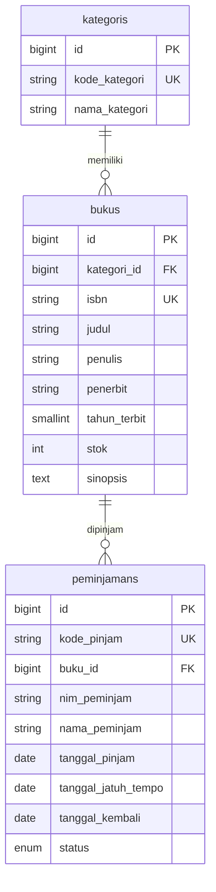

# SIPUS-Del — Tahap 2

Sistem Informasi Perpustakaan Kampus Del untuk tugas Minggu 6: katalog dan CRUD buku/kategori, transaksi peminjaman/pengembalian, statistik, pencarian, serta autentikasi pustakawan dengan sesi database.

**Versi proyek:** `composer.json` menggunakan Laravel **13** (`^13.0`) dan PHP **8.3+**, meskipun modul tugas mengacu pada Laravel 11. Dependensi proyek Minggu 5 dipertahankan; tidak dilakukan downgrade. Verifikasi lokal menggunakan PHP 8.4.26 dan MySQL 8.0.30.

## Instalasi

Prasyarat: Composer, PHP dengan ekstensi yang diminta Composer termasuk `pdo_mysql`, MySQL, serta `pdo_sqlite`/`sqlite3` untuk pengujian. Folder `bootstrap/cache`, `storage/framework/cache/data`, `storage/framework/sessions`, `storage/framework/views`, dan `storage/logs` harus tersedia dan dapat ditulis.

```powershell
composer install
cp .env.example .env
php artisan key:generate
```

Salin `.env.example` **hanya pada instalasi baru**. Pada PowerShell, `cp` adalah alias `Copy-Item`. Buat database `sipus_del` di MySQL dan sediakan pengguna yang berhak mengaksesnya. Sesuaikan kredensial lokal sendiri; contoh konfigurasi memakai `DB_CONNECTION=mysql`, `DB_DATABASE=sipus_del`, `DB_USERNAME=sipus`, password kosong sebagai placeholder, dan `SESSION_DRIVER=database`. Jangan menimpa `.env` yang sudah berfungsi.

```powershell
php artisan config:clear
php artisan db:show
php artisan migrate:fresh --seed
php artisan serve
```

`migrate:fresh --seed` menghapus seluruh tabel pada database yang dipilih. Gunakan untuk menyiapkan ulang data latihan. Buka http://127.0.0.1:8000. Bootstrap dimuat melalui CDN; build Node/Vite tidak diperlukan untuk halaman perpustakaan.

## Akun dan data uji

- Email: **pustakawan@del.ac.id**
- Kata sandi: **password123**
- Seeder berjalan berurutan: `KategoriSeeder`, `BukuSeeder`, `PustakawanSeeder`, `PeminjamanSeeder`.
- Hasil: 5 kategori, 20 buku, 1 pustakawan, 2 peminjaman aktif, 1 pengembalian, total stok tersedia 55.
- Buku pertama memiliki stok awal 1 dan satu pinjaman aktif, sehingga tersedia 0. Buku kedua memiliki stok awal 2 dan satu pinjaman aktif, sehingga tersedia 1. Buku lain memiliki stok awal 3; riwayat yang sudah dikembalikan tidak mengurangi stok tersedia.

## Penggunaan

Katalog dan detail buku/kategori boleh dibaca publik. Masuk melalui navbar untuk mengelola buku/kategori dan transaksi. Buka bagian **Pinjam** pada baris buku, isi NIM dan nama, lalu kirim. Daftar **Peminjaman** menyediakan tombol **Kembalikan** pada pinjaman aktif.

Pencarian mencakup judul, penulis, dan ISBN; kategori dapat digabungkan dengan pencarian. Kata pencarian terakhir disimpan pada `last_search` dan digunakan kembali ketika parameter pencarian tidak diberikan. Kirim pencarian kosong untuk menghapusnya. `last_borrower` mengisi ulang NIM/nama dari transaksi terakhir yang berhasil.

Navbar menampilkan nama pustakawan dan waktu login sesuai zona waktu aplikasi. Keluar menggunakan POST dan CSRF; sesi diinvalidasi dan token CSRF dibuat ulang.

## Struktur dan ERD

- Model: `Buku`, `Kategori`, `Peminjaman`, `User`.
- Controller: `BukuController`, `KategoriController`, `PeminjamanController`, `AuthController`.
- View: `resources/views/buku`, `kategori`, `peminjaman`, `auth`, dan komponen layout Bootstrap bersama.
- Rute: `buku.*`, `kategori.*`, `peminjaman.index`, `peminjaman.pinjam`, `peminjaman.kembali`, `login`, `login.store`, `logout`.
- Semua rute create/store/edit/update/destroy buku dan kategori, pinjam, kembali, daftar peminjaman, serta logout memakai middleware `auth`.
- Model Peminjaman menetapkan nama tabel `peminjamans` secara eksplisit agar tidak mengikuti tebakan plural bahasa Inggris.



Ketiga tabel memiliki timestamps. FK kategori memakai `restrict`, sementara penghapusan buku menghapus riwayat peminjamannya melalui `cascadeOnDelete`, sesuai spesifikasi tugas. `users` menyimpan akun pustakawan; `sessions` menyimpan sesi login database. Identitas peminjam disimpan langsung sebagai NIM/nama pada peminjaman.

## Transaksi ACID dan kueri

- **Atomicity:** pengurangan stok dan pembuatan pinjaman berada dalam satu `DB::transaction(..., 3)`. Kegagalan insert memicu rollback, termasuk pengurangan stok sebelumnya.
- **Consistency:** stok nol ditolak; NIM dinormalisasi trim dan uppercase; satu NIM tidak dapat meminjam buku yang sama selama pinjaman sebelumnya aktif. Kode pinjam unik dan foreign key menjaga referensi data.
- **Isolation:** pinjam mengunci baris buku dengan `lockForUpdate`. Kembali mengunci buku kemudian peminjaman, memeriksa status, dan hanya menambah stok satu kali. Urutan penguncian buku lebih dahulu dipakai untuk mengurangi deadlock; Laravel diberi tiga percobaan transaksi.
- **Durability:** perubahan di-commit ke MySQL. Jaminan ketahanan terhadap kegagalan perangkat bergantung pada konfigurasi penyimpanan/MySQL.

`QueryException` dicatat dengan awalan `[DB EXCEPTION PINJAM]` atau `[DB EXCEPTION KEMBALI]`; antarmuka hanya menerima pesan umum. Penolakan aturan bisnis memakai flash error; transaksi sukses memakai flash success. ID yang tidak ditemukan menghasilkan 404.

Katalog memakai eager loading `with('kategori')`, `withCount('peminjamans')`, `when()`, grup `where` untuk tiga kondisi pencarian, serta `paginate(10)->withQueryString()`. Statistik global memakai empat kueri `DB::table`. Delapan kueri data katalog: tiga kueri pagination/eager loading, satu daftar pilihan kategori, dan empat statistik. Jumlahnya tidak bertambah satu per buku. Audit Minggu 5 di `docs/sql-audit.md` adalah catatan historis sebelum penambahan filter/statistik.

## Pengujian dan bukti

```powershell
php artisan test
php artisan route:list -v --except-vendor
php vendor/bin/pint --test app database routes tests lang
php artisan view:cache
php artisan view:clear
```

`phpunit.xml` memaksa `DB_CONNECTION=sqlite`, `DB_DATABASE=:memory:`, dan `DB_URL` kosong. Test `RefreshDatabase` berjalan pada SQLite sementara, terpisah dari MySQL pengembangan. Jangan mengubah koneksi test menjadi database pengembangan.

Hasil verifikasi 18 Oktober 2026:

| Pemeriksaan | Hasil |
| --- | --- |
| MySQL `db:show` | MySQL 8.0.30, database sipus_del, pengguna sipus |
| Migrasi dan seeder | Berhasil; data sesuai rincian di atas |
| Render katalog menggunakan MySQL | HTTP 200 |
| PHPUnit | 30 test, 746 assertion lulus |
| Stok nol | Ditolak, stok tetap 0, tidak ada pinjaman baru |
| NIM ganda termasuk variasi huruf/spasi | Ditolak, stok tidak berkurang lagi |
| Pengembalian dan pengembalian berulang | Stok bertambah sekali; pengembalian kedua ditolak |
| Insert gagal setelah decrement | Kode duplikat memicu rollback; stok tetap konsisten |
| Filter gabungan dan eager loading | Filter kategori tetap berlaku; kueri tetap terbatas |
| Login/logout | Regenerasi ID sesi, timestamp, invalidasi sesi, regenerasi token lulus |
| Cookie email | HttpOnly dan masa berlaku 7 hari terverifikasi lewat response test |
| Rute tamu | Seluruh rute mutasi dan daftar peminjaman redirect ke login |
| Blade | Kompilasi view berhasil |

SQLite tidak membuktikan perilaku penguncian baris MySQL. Untuk pemeriksaan konkurensi manual, gunakan dua sesi browser/pustakawan dan buku dengan stok 1: kirim dua peminjaman dengan NIM berbeda hampir bersamaan. Hasil yang diharapkan: satu berhasil, satu ditolak, stok akhir 0, hanya satu pinjaman baru. Pengujian konkurensi MySQL ini belum dijalankan otomatis.

### Audit cookie dan sesi

Login menjalankan `Auth::attempt`, regenerasi sesi, menyimpan `login_timestamp`, dan mengantrekan `del_last_user_email` selama 10080 menit. Cookie email menggunakan HttpOnly bawaan CookieJar dan dienkripsi middleware Laravel; isinya di DevTools tidak harus berupa email yang dapat dibaca. Periksa HttpOnly, tanggal kedaluwarsa sekitar tujuh hari, path, SameSite, dan cookie sesi pada DevTools. Cookie sesi menggunakan HttpOnly sesuai konfigurasi session proyek. Flag Secure mengikuti konfigurasi/HTTPS; lingkungan HTTP lokal tidak membuktikan konfigurasi produksi.

Opsi **Ingat saya** mengaktifkan remember cookie Laravel. Setelah logout, cookie email tetap ada untuk mengisi form login, tetapi sesi autentikasi lama tidak berlaku. Verifikasi manual dengan membuka kembali halaman peminjaman setelah logout: harus diarahkan ke login.

`.env`, `vendor/`, log, dan cache tidak boleh masuk commit. Pekerjaan disimpan pada branch `week6-db-session`; tidak dilakukan git push.
